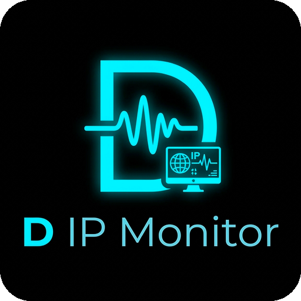

# D IP Monitor

A modern, high-performance network host and IP monitoring tool built with Python and PyQt6. Features a futuristic Cyber Glassmorphism UI, real-time ICMP ping engine, multi-channel alerts (Email, Sound, System Popups, Discord/Slack/Teams Webhooks), live latency sparkline trends, and a floating desktop HUD.



## Key Features

- **Concurrent Ping Engine**: Multi-threaded ICMP ping monitoring with configurable intervals and packet loss calculation (5% granular steps).
- **Live Latency Trend**: Interactive real-time sparkline graph with hover details, crosshair tracking, latency badges, and historical stats.
- **Multi-Channel Alert System**:
  - **Email Alerts**: Automatic SMTP notifications on status change (Online / Offline).
  - **System Popups & Sound**: Visual notifications and audio cues on state transitions.
  - **Webhooks**: Multi-platform webhook integration for Discord, Slack, Microsoft Teams, Telegram, and generic JSON endpoints with per-host toggles.
- **Mini Floating HUD**: Sleek cyber-styled desktop widget displaying real-time UP / DOWN host counts, average latency, and network health percentage.
- **Group Categorization & Search**: Dynamic group dropdown and real-time instant search across IP addresses, tags, descriptions, and statuses.
- **Diagnostic Toolkit**: Built-in Ping, Traceroute, and Port Scanner utilities.
- **Import / Export**: Batch IP Scanner, CSV export/import, and profile configuration backup & restore.

## Requirements

- Python 3.10+
- PyQt6

```bash
pip install PyQt6
```

## Quick Start

1. Clone the repository:
   ```bash
   git clone https://github.com/Ronak-Patra/D-IP-Monitor.git
   cd D-IP-Monitor
   ```

2. Copy the sample settings file:
   ```bash
   copy settings.example.ini settings.ini
   ```

3. Run the application:
   ```bash
   python main.py
   ```

## Building Standalone Executable (.exe)

```bash
pip install pyinstaller
pyinstaller --clean --noconfirm main.spec
```
The compiled executable will be located in the `dist/` directory.

## License

MIT License. Developed by D.
